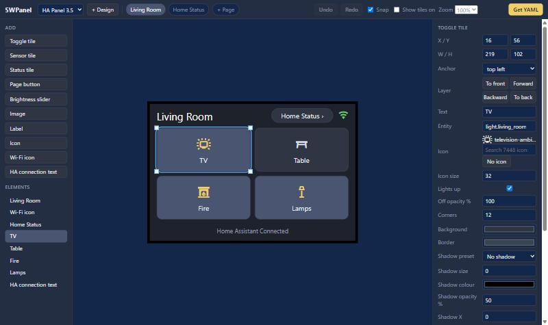

# SWPanel

A drag-and-drop designer for ESPHome touch panels. Build a Home Assistant dashboard in your browser,
and SWPanel writes the ESPHome YAML for you. There's no LVGL to learn, and you don't have to write any
YAML.

Laying out an LVGL dashboard by hand usually means working out coordinates, rebuilding the firmware to
see the result, then doing it all again for each small change. SWPanel lets you do that part on screen,
so you only flash the panel once you're happy with the design.

1. **Lay it out.** Drag tiles, sliders, images and icons onto a true-size picture of your screen, then
   change their size, colours and fonts.
2. **Connect it.** Pick your Home Assistant entities from a list. The preview follows their real states,
   so you can see how the dashboard will look before you flash anything.
3. **Put it on your panel.** Paste the finished YAML into ESPHome Builder and install it. It includes
   the display and touch settings for your panel, and your Wi-Fi details and keys stay in `secrets.yaml`.

SWPanel runs as a Home Assistant add-on or on its own in Docker, and can hold a separate design for each
of your panels. It currently supports [two displays](#supported-displays). The designer doesn't talk to
the panel directly, so changes reach it the next time you install from ESPHome Builder.



&nbsp;

## Contents

- [Features](#features)
- [Supported displays](#supported-displays)
- [Install](#install)
  - [Home Assistant add-on](#home-assistant-add-on)
  - [Docker Compose](#docker-compose)
- [Settings](#settings)
- [Using the designer](#using-the-designer)
  - [Layers and the screen edge](#layers-and-the-screen-edge)
  - [Styling](#styling)
  - [Entity lookup and live states](#entity-lookup-and-live-states)
  - [Images](#images)
  - [Brightness sliders](#brightness-sliders)
- [Putting it on your panel](#putting-it-on-your-panel)
- [Limits](#limits)
- [Security](#security)
- [Development](#development)
- [Credits and licence](#credits-and-licence)

&nbsp;

## Features

- Move, resize, recolour, add and remove elements, with undo and redo
- Toggle, sensor and status tiles, page buttons, brightness sliders, images, labels, icons,
  a Wi-Fi icon and Home Assistant connection text
- Live preview that follows your real Home Assistant states
- Entity lookup, so you can pick entities from a list
- All 7,448 Material Design Icons, five fonts and any size you like
- Themes, 92 shadow presets, layers, and elements that run past the screen edge
- A separate design for each panel
- Runs as a Home Assistant add-on or on its own in Docker, on arm64 and amd64
- Works on an isolated LAN, as all its fonts and icons are stored locally

&nbsp;

## Supported displays

| Display | Screen | Board | Status |
|---|---|---|---|
| Waveshare 3.5inch RPi LCD (A) | 480x320, XPT2046 touch | ESP32 (WROOM-32) | Running on real hardware. See the [wiring and setup guide](docs/waveshare-35.md) |
| Elecrow CrowPanel 7.0 inch (DIS08070H) | 800x480, GT911 touch | ESP32-S3 with 8 MB PSRAM | Running on real hardware |

> [!NOTE]
> The CrowPanel settings are confirmed on one board of unknown hardware version. If colours are
> wrong or the image is unstable on yours, check `pclk_frequency` and the porch timings in
> `designer/hardware/crowpanel_7.yaml.j2`. The first flash has to be over USB. This is the
> DIS08070H, not the CrowPanel **Advance**, which uses different pins.

&nbsp;

## Install

### Home Assistant add-on

The add-on (Home Assistant now calls these apps) opens from the sidebar behind your Home
Assistant login, and entity lookup works with no token. It needs Home Assistant OS or Supervised.

1. Go to **Settings > Apps > Install app**, open the top-right menu and select **Repositories**.
2. Add `https://github.com/pqpxo/SWPanel`.
3. Open **SWPanel** in the store, then select **Install** and **Start**. Home Assistant builds
   the image on your machine, so this can take a few minutes.
4. Turn on **Show in sidebar**.

> [!TIP]
> On a network with no internet access, build a zip with the command below and extract it into
> Home Assistant's `local_apps` folder, so that you have `local_apps/swpanel/config.yaml`. Older
> installs call this folder `addons`. Then select **Check for updates** in the same menu.
>
> `git -c core.autocrlf=false archive --format=zip --prefix=swpanel/ -o swpanel.zip HEAD:designer`

### Docker Compose

On a Raspberry Pi or Linux host with Docker:

```bash
git clone https://github.com/pqpxo/SWPanel.git
cd SWPanel/designer
cp .env.example .env
mkdir -p data
docker compose up -d --build
```

Then open `http://<host>:8095`.

> [!TIP]
> Create `data` yourself before the first start. If Docker creates it, root owns it and the app
> can't write there. The container runs as UID 1000, so if your user is different, run
> `sudo chown 1000 data`.

> [!IMPORTANT]
> The Docker version has no login. Keep it on your LAN, or add an access list in your reverse
> proxy. It serves plain HTTP, and works behind a proxy that handles TLS.

Your designs and images are stored in `data/` and survive `docker compose down` and `up --build`.

&nbsp;

## Settings

These apply to the Docker version. Set them in `designer/.env`.

| Variable | Default | Purpose |
|---|---|---|
| `PORT` | `8095` | Port the app listens on |
| `PUBLIC_URL` | Your browser's address | Address ESPHome uses to download images, such as `http://192.168.1.10:8095` |
| `HA_URL` | Not set | Home Assistant address for entity lookup, such as `http://homeassistant.local:8123` |
| `HA_TOKEN` | Not set | Long-lived access token for entity lookup |

The add-on has one setting, **Image address**, described in its
[documentation](designer/DOCS.md#image-address). Its port is off by default, as you reach it through
Home Assistant.

&nbsp;

## Using the designer

1. Drag elements to move them, and drag a selected element's corners to resize it.
2. Click an element to change its text, entity, icon, size and colours on the right.
3. Add elements by clicking or dragging from the left. **+ Page** adds a page, with a button to
   reach it and one back.
4. Use **+ Design** to start a design for another panel or display.
5. Select **Get YAML**, then **Copy** or **Download**.

Changes save automatically, and designs saved by older versions keep working.

| Keys | Action |
|---|---|
| Arrow keys (Shift for 10px) | Nudge the selected element |
| Delete | Delete it |
| Ctrl+D | Duplicate it |
| Ctrl+Z, Ctrl+Y | Undo, redo |

### Layers and the screen edge

**Layer** moves the selected element in front of or behind others. The **Elements** list runs
from back to front, and the panel draws in the same order.

Elements can run up to one screen past each edge and be up to twice the screen's size. The
designer dims anything outside the screen, and the panel cuts it off.

### Styling

| Setting | Applies to | Notes |
|---|---|---|
| Font | Anything with text | Montserrat, or Roboto, Inter, Poppins and Oswald in regular and bold |
| Text size | Anything with text | Pick a size or type one from 8 to 120 |
| Off opacity | Toggle and status tiles | Fades the whole tile while it's off or not in its good state |
| Shadow | Tiles and page buttons | Pick a preset, or set size, colour, opacity, position and spread |
| Icon | Anything with an icon | Browse them, or search by name, with or without `mdi:` |
| Icon size | Anything with an icon | Pick a size or type one from 8 to 240 |

Click an empty part of the screen to find the **Theme** settings: page background, tile background,
border, tile when on, text, icons, font and corners. A change applies to every page in the design,
and you can still change a single element afterwards.

The shadow presets are numbered to match the
[CSS Scan examples](https://getcssscan.com/css-box-shadow-examples). The panel can only draw one outer
shadow, so presets marked **simplified** keep the most visible layer of the original, and 4 inner-only
examples are left out.

> [!NOTE]
> Each font and size takes up flash. Fonts other than built-in Montserrat are downloaded from Google
> Fonts when ESPHome compiles, so ESPHome Builder needs internet access. Shadows can make the 3.5 inch
> panel redraw slowly, because it has no PSRAM.

### Entity lookup and live states

The add-on does this with no setup. For the Docker version:

1. In Home Assistant, open your user profile and create a long-lived access token.
2. Set `HA_URL` and `HA_TOKEN` in `designer/.env`.
3. Run `docker compose up -d` to apply it.

Each entity box then suggests matching entities and warns you if the one you've typed doesn't exist.
The preview shows real states, refreshed every 3 seconds: tiles light up, and sensors, status tiles and
sliders show their current values. Clicking a tile selects it rather than switching it. Tick
**Show tiles on** to style the on colours whatever the real state is.

> [!CAUTION]
> A long-lived token has the same access as your Home Assistant user. Consider making a separate
> non-admin user for it. The token stays on the server and never reaches the browser, but never commit
> your `.env` file.

### Images

Add an **Image** to upload a PNG or JPEG of up to 5 MB. ESPHome downloads it from the designer when it
compiles, so ESPHome Builder must be able to reach the address in the YAML. For the Docker version,
that's the address in your browser unless you set `PUBLIC_URL`.

> [!WARNING]
> Images are built into the firmware and use a lot of flash. A full-screen image can use about 450 KB
> on the 3.5 inch panel and 1.1 MB on the CrowPanel, and the settings panel shows the most each image
> can use. The build fails if the firmware no longer fits.

### Brightness sliders

Add a **Brightness slider** and pick a light. It sets the brightness when you let go, and moves to match
if the light changes elsewhere. Make it taller than it is wide for a vertical slider.

&nbsp;

## Putting it on your panel

1. Add these to your `secrets.yaml` in ESPHome Builder. `secrets.example.yaml` shows the format.

   ```yaml
   wifi_ssid: "your-ssid"
   wifi_password: "your-wifi-password"
   api_encryption_key: "from: openssl rand -base64 32"
   ```

2. Paste the YAML over your device's config in ESPHome Builder and install it. Flash over USB the first
   time.
3. In Home Assistant, add the device, then open its ESPHome options and tick **Allow the device to
   perform Home Assistant actions**.

> [!IMPORTANT]
> Without that last step, button presses silently do nothing.

The YAML only contains `!secret` references, so your Wi-Fi password and keys never reach the designer.
Keep the device name the same as the panel you flashed, or Home Assistant sees a new device.

&nbsp;

## Limits

- The preview is close, not pixel-perfect, because the panel draws its own fonts. The real panel is the
  final check.
- Built-in Montserrat only has basic Latin letters, plus `°` and `•`. It comes in even sizes from 10 to 48.
  Other sizes are downloaded, and those and the other fonts include any character you type, if the font
  has it.
- A tile's contents are cut off at its edges on the panel, but not in the preview.
- An element far to the left of or above the screen may be out of view. Zoom out to reach it, or select it
  in the **Elements** list and type its position.
- Changes reach the panel only after an ESPHome rebuild and install.
- It doesn't read YAML back in, so hand edits made in ESPHome Builder won't appear in the designer.
- Deleting an image element leaves its file in the data folder.

&nbsp;

## Security

- Under the Docker setup, anyone who can reach the designer can edit designs, and can see your entity
  names and states if you turn on entity lookup.
- Uploaded images can be downloaded without logging in, on both setups, because ESPHome fetches them when
  it compiles.
- The add-on only accepts the designer from Home Assistant's Ingress, so it stays behind your login. It
  gets administrator-level API access from Home Assistant, and only uses it to read entity states.
- Nothing is sent anywhere except your own Home Assistant. Google Fonts and GitHub are only contacted by
  ESPHome when it compiles.

&nbsp;

## Development

```bash
cd designer
pip install -r requirements-dev.txt
python -m pytest
```

If `esphome` is installed, the tests also run its validator on the output.

- `yamlgen.py` validates a design and renders `panel.yaml.j2`, which includes the fixed settings for each
  display from `hardware/`.
- `ha-panel-35.yaml` is a plain ESPHome config for the 3.5 inch panel. A test checks that
  `default_design.json` still produces it, so update both together.
- Give any new element setting a default in `yamlgen.upgrade()`, so older designs keep working.
- To add a display, add it to `DISPLAYS` in `yamlgen.py` and `STARTERS` in `app.py`, add
  `hardware/<id>.yaml.j2` and a starter JSON file, and copy that file in the `Dockerfile`.
- Page URLs must stay relative, or they break under Home Assistant's Ingress.

&nbsp;

## Credits and licence

SWPanel is released under the [MIT licence](LICENSE). The files in `designer/static/vendor` keep their own
licences, which are stored beside them:

- [Material Design Icons](https://pictogrammers.com/library/mdi/) by Pictogrammers
- [Roboto](https://github.com/googlefonts/roboto-classic), [Inter](https://github.com/rsms/inter),
  [Poppins](https://github.com/itfoundry/Poppins) and [Oswald](https://github.com/googlefonts/OswaldFont),
  under the SIL Open Font License

Built on [ESPHome](https://esphome.io/) and [LVGL](https://lvgl.io/).
