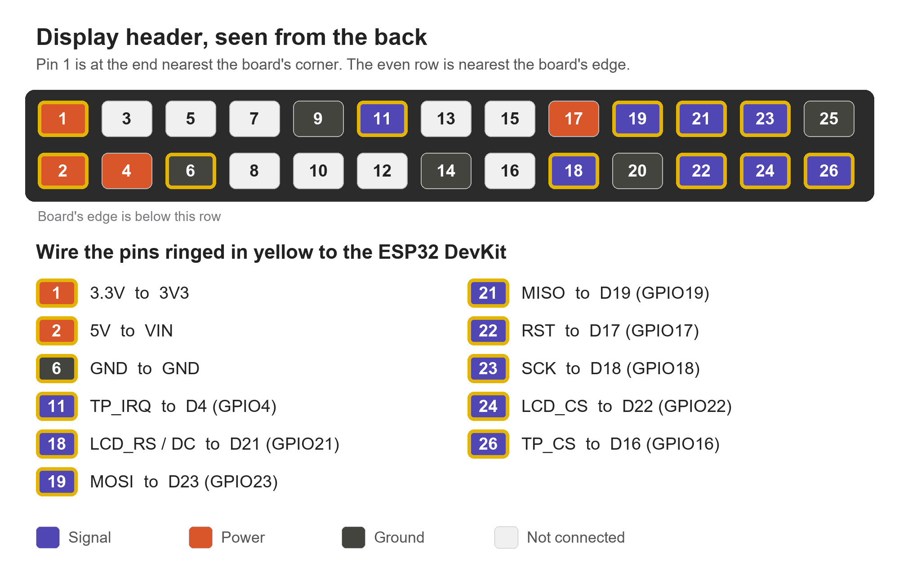

# Waveshare 3.5inch RPi LCD (A) on an ESP32

Wiring and setup for driving this Raspberry Pi display from an ESP32 DevKit (ESP-WROOM-32, 30-pin).

Use SWPanel to design the dashboard. It includes all these settings. `ha-panel-35.yaml` in this repository
is the same starting layout as a plain ESPHome config, validated against ESPHome 2026.10.2.

&nbsp;

## Contents

- [Wiring](#wiring)
- [Hardware notes](#hardware-notes)
- [First start](#first-start)
- [Touch calibration](#touch-calibration)

&nbsp;

## Wiring

| Header pin | Signal | DevKit label | GPIO |
|---|---|---|---|
| 1 | 3.3V | 3V3 | |
| 2 | 5V | VIN | |
| 6 | GND | GND | |
| 11 | TP_IRQ | D4 | 4 |
| 18 | LCD_RS / DC | D21 | 21 |
| 19 | MOSI (LCD/TP SI) | D23 | 23 |
| 21 | MISO (TP SO) | D19 | 19 |
| 22 | RST | D17 | 17 |
| 23 | SCK | D18 | 18 |
| 24 | LCD_CS | D22 | 22 |
| 26 | TP_CS | D16 | 16 |

> [!TIP]
> Pin 1 is at the end of the header nearest the board's corner, and even pins are on the row nearest the
> board's edge. To confirm with a multimeter in continuity mode, pins 2 and 4 (both 5V) beep together, and
> so do pins 6 and 9 (both GND). [bring-up-checks.xlsx](bring-up-checks.xlsx) is a checklist for each wire and
> supply voltage.

> [!WARNING]
> D16 and D17 are labelled RX2 and TX2 on some boards. Don't use TX0 and RX0, which are the USB serial pins.

&nbsp;

## Hardware notes

- **Panel:** an ILI9486 behind 74HC4094 shift registers, at 480x320. The board expects every SPI write as 16
  bits, so it needs `mipi_spi` with `spi_16: true`. Plain ILI9486 setups give a white screen.
- **Touch:** XPT2046 resistive, sharing SCK and MOSI with the LCD, with its own CS and MISO. LVGL rotates both
  the display and touch by 90 degrees, so the touch transform only maps raw axes to native portrait.
- **SPI speed:** 16MHz. 20MHz corrupted the image over jumper wires, and 10MHz worked but was slow.
- **Power:** 5V from VIN into header pin 2 feeds the onboard regulator, and 3V3 goes to pin 1. Both sides use
  3.3V logic.
- **Backlight:** no control pin, so it's always on.
- **Memory:** the WROOM-32 has no PSRAM, so LVGL draws in 1/8-screen strips (`buffer_size: 12%`).

&nbsp;

## First start

1. Copy `secrets.example.yaml` to `secrets.yaml` and fill it in, if you're using `ha-panel-35.yaml` directly.
2. Flash over USB the first time.
3. In Home Assistant, give the integration your API encryption key when you add the device.
4. Open the device's ESPHome options and tick **Allow the device to perform Home Assistant actions**. Without
   this, button presses silently do nothing.
5. If you rename the device, remove and add it again in Home Assistant.

If the display doesn't look right:

| Problem | Fix |
|---|---|
| Colours inverted | Set `invert_colors: true` |
| Red and blue swapped | Set `color_order: rgb` |
| Upside down | Set the `lvgl` `rotation` to 270 |
| Glitches or noise | Lower `data_rate` to 10MHz or shorten the wires |

In `ha-panel-35.yaml`, tiles count as on for any state except off, unavailable, unknown or standby. You can
point them at lights, switches, media players or climate entities, as they all use `homeassistant.toggle`. The
entities in that file are examples, set in `substitutions`, so change them to your own.

&nbsp;

## Touch calibration

Touch coordinates are in the panel's native portrait orientation (320x480), because LVGL rotates them. This
panel needs `mirror_x: true` and `mirror_y: true`.

To calibrate your own panel, use the `on_touch` lambda in `ha-panel-35.yaml`, which logs `x_raw` and `y_raw` for each press:

1. Watch the logs and press each corner with the stylus.
2. Set `x_min`/`x_max` and `y_min`/`y_max` to the smallest and largest raw values you see. Min must stay below
   max.
3. If sliding along the panel's short edge changes `y_raw`, set `swap_xy: true`.
4. If a press lands on the wrong side, flip `mirror_x` or `mirror_y`.
5. Remove the logging lambda when you've finished.
